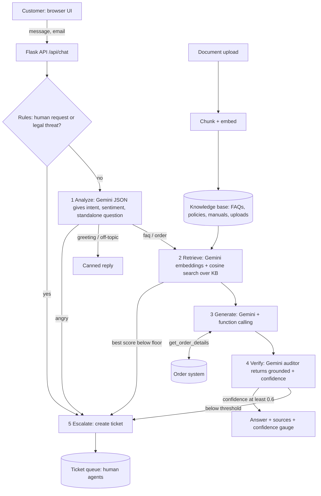

# SupportGen: AI Customer Support Assistant

## Problem statement
Support teams answer the same questions about returns, shipping, warranty and products all day, while the answers already sit in FAQs, policy PDFs and manuals. Generic chatbots either cannot see those documents or make up answers when they are unsure, which is worse than no answer for policies, prices and refunds.

**SupportGen** is a Retrieval-Augmented Generation (RAG) support agent. It answers only from the company's own documents, looks up live order data with tool calling, checks its own answer before sending it, and **hands the conversation to a human (by creating a ticket) whenever it is not confident**.

## Features
| Requirement | How it is met |
|---|---|
| Answer from FAQs, policies, docs | RAG over `data/sample_docs/` (FAQ, refund, shipping, product manual) |
| Retrieve from uploaded documents | Upload `.txt`, `.md`, `.pdf` in the UI; indexed instantly |
| Accurate, context-aware answers | Grounded prompt + citations `[1]`, conversation memory, follow-up question rewriting |
| Handle FAQs automatically | High-confidence answers are sent with no human involved |
| Escalate when unsure | Retrieval gate + Gemini self-verification + confidence threshold + explicit "human" and anger rules, all creating a ticket |
| Agentic workflow | Multi-step pipeline; Gemini function calling (`get_order_details`); tool + policy reasoning ("Can I return order SG1003?") |
| Testing and limitations | `pytest` suite (16 tests) and `tests/run_eval.py` probe table |

## Architecture


## Tech stack
Python 3.10+, Flask, Google Gemini API (`google-genai` SDK: generation, JSON mode, function calling, `gemini-embedding-001`), NumPy vector search, pypdf, vanilla HTML/JS frontend, pytest.

## Setup
```bash
python -m venv venv && source venv/bin/activate     # Windows: venv\Scripts\activate
pip install -r requirements.txt
cp .env.example .env                                # then paste your key from https://aistudio.google.com/apikey
python app.py                                       # open http://localhost:5000
```
No key? The app still runs in **offline demo mode** (TF-IDF search, rule-based analysis, extractive answers). The badge in the sidebar shows which mode is active.

Model names change often. If you get errors, set `GEMINI_MODEL` in `.env` to a current Flash model listed at https://ai.google.dev/gemini-api/docs/models. Note that Google now recommends its newer Interactions API for new projects; this project uses `generateContent`, which is still supported.

## Project structure
```
app.py          Flask routes: chat, upload, documents, tickets
agent.py        Pipeline: rules, analyze, retrieve, generate, verify, escalate
rag.py          Reading, chunking, Gemini-embedding / TF-IDF search
llm.py          Gemini wrapper (generate, JSON mode, tools, embeddings)
tools.py        get_order_details tool + ticket store
templates/      Chat UI (confidence gauge, sources, agent-steps panel, ticket queue)
data/sample_docs/   Demo knowledge base
tests/          test_supportgen.py, test_gemini_pipeline.py, run_eval.py
```

## Team members and responsibilities
| Member | Responsibility |
|---|---|
| _Name 1_ | Backend (Flask API, session handling) |
| _Name 2_ | RAG pipeline (chunking, embeddings, retrieval tuning) |
| _Name 3_ | Agent workflow (prompts, tool calling, verification, escalation) |
| _Name 4_ | Frontend (chat UI, upload, ticket queue) |
| _Name 5_ | Testing, evaluation, documentation, presentation |

## Testing
```bash
pytest -q                    # 16 tests, no API key or network needed
python tests/run_eval.py     # probe table; uses Gemini if GEMINI_API_KEY is set
```
* `test_supportgen.py` exercises the full HTTP API in offline mode: FAQ with source, order tool, multi-turn order ID, unknown order, escalation, ticket resolve, upload then query, input validation, chunking.
* `test_gemini_pipeline.py` tests the Gemini-mode logic with a fake LLM: confident answer, low confidence escalation, ungrounded answer capped, API outage escalates, embedding failure falls back to TF-IDF.
* The fake-LLM tests do **not** prove real Gemini quality. Run `tests/run_eval.py` with your key and record the results in the table below for your demo.

## Known limitations (observed with `tests/run_eval.py`, offline mode)
| Probe | Offline result | Why / what Gemini mode changes |
|---|---|---|
| "can i send stuff back if i changed my mind" | Escalated | TF-IDF is lexical; it cannot match paraphrases. Gemini embeddings should retrieve the return policy. |
| "Do you sell electric scooters?" | Escalated | Correct: not in the documents, so the bot refuses to guess. |
| "Who won the 2011 cricket world cup?" | Escalated | Offline mode cannot tell off-topic from unanswerable. Gemini mode classifies it `off_topic` and declines politely. |
| "Can I return order SG1003?" | Shows order details only | Offline mode cannot combine the tool result with the 30-day policy. Gemini mode can (days_since_delivery = 45). |
| Angry customer, "talk to a human" | Escalated (high priority) | Keyword rules offline; Gemini sentiment in Gemini mode. |
| Hindi question | Escalated | TF-IDF is English-only. Gemini embeddings are multilingual. |
| Prompt injection ("ignore your rules...") | Escalated | Mitigated by prompt rules, grounding and the auditor, but **not guaranteed**: injection resistance is never perfect. |

Other limitations to mention in your presentation:
* **Confidence is an estimate.** The auditor is an LLM, so it can be wrong in both directions. Tune `CONFIDENCE_THRESHOLD` and `MIN_RETRIEVAL` (in `agent.py`) on your own data; the Gemini cosine floor of 0.50 is an untested starting value.
* **Retrieval can miss.** Fixed-size chunking can split related facts; scanned PDFs need OCR (not included).
* **Mock data and in-memory sessions.** Orders are hard-coded in `tools.py`; conversation memory resets on restart; tickets are stored in a JSON file. There is no authentication, so a real deployment must verify the customer before showing order data.
* **Latency and cost.** Gemini mode makes 2 to 3 LLM calls per question (analyze, answer, verify).

## Future work
Hybrid (keyword + vector) search, re-ranking, helpdesk integration (Zendesk, Freshdesk), customer login, streaming responses, feedback buttons to tune the threshold, and OCR for scanned documents.
